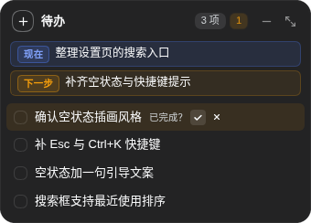
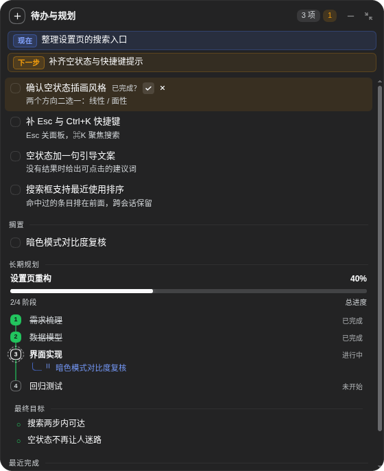

<div align="center">


<p><strong>A draggable to-do note on every DeepSeek Harness session</strong><br>
Short-term tasks, long-term plan progress, and a live memory snapshot for the agent.</p>

<p>
  <a href="LICENSE"></a>
  
  
  
</p>

<p><a href="README.md">中文</a> · <strong>English</strong></p>

</div>

---

Todo Note is a DeepSeek Harness (DSH) plugin that puts a sticky note in the top-right corner of every session. It keeps three things in one place:

- **You** no longer scroll the transcript to answer "where are we, what is next, what got parked";
- **The long-term plan** has real phase progress instead of a slogan;
- **The agent** receives a few lines of live state each turn, so it does not re-read the conversation to remember context.

Everything is stored locally. No network calls, no telemetry.

<details>
<summary>Table of contents</summary>

- [Preview](#preview)
- [Features](#features)
- [Install](#install)
- [Usage](#usage)
- [Agent tools](#agent-tools)
- [Configuration](#configuration)
- [Data and privacy](#data-and-privacy)
- [Cross-platform](#cross-platform)
- [Implementation](#implementation)
- [Troubleshooting](#troubleshooting)
- [Development](#development)
- [License](#license)

</details>

## Preview

The screenshots below use fictional demo data.

<table>
  <tr>
    <td align="center" width="42%">
      
      <br><sub><b>Note (default)</b><br>now / next, active tasks, height follows content</sub>
    </td>
    <td align="center" width="58%">
      
      <br><sub><b>Detail</b><br>tasks and notes, shelved branches, phase timeline, goals, recently done</sub>
    </td>
  </tr>
</table>

<p align="center">
  
  <br><sub><b>Floating ball</b>: drag handle only; click to return to the note</sub>
</p>

## Features

**Short-term tasks**

- `now` / `next` focus rows with blue and amber badges; text wraps fully, never truncated.
- Active task list where order is priority; drag a row to reorder live.
- Hover a row to reveal "shelve / delete" without stealing title width.

**Long-term plan**

- Phase timeline: completed phases get a green number and a green trunk; the active phase gets a blue number with a spinning dashed ring.
- Progress is weighted by phase; it never shows 100% while a phase is open.
- Parked work can hang under its phase as a blue elbow branch.

**Completion is yours to confirm**

- After the agent calls `todo_note_complete`, the task becomes `awaiting` and a right-aligned `Done? ✓ ✗` row appears under the title. It sits on its own line, so the hover-only shelve/delete buttons can never cover it.
- Only ✓ finishes it: strike, fade, then height collapse — played once.
- ✗ returns it to active with a `rejects` count; the agent's next snapshot says "用户未通过" so it reflects before retrying.

**Memory injection**

- One static usage section (prompt order 40) plus a live per-session snapshot (order 41, at most six lines).
- Edit the note and the next turn's snapshot follows; loading the plugin mid-session attaches the snapshot to agents already running.

**Interaction**

- Three shapes: note, floating ball, detail. Shape and position persist in `localStorage`.
- Resizing expands toward the anchored quadrant and collapses back to the exact original rectangle.
- Both the note and the detail view size to their content: the note caps at 420px and the detail at `min(82vh, 720px)`, so a short checklist does not sit in an oversized empty frame.
- Drag the header to move, double-click to reset. The note and the detail view snap and glide in near an edge with a 16px margin; **the ball stays exactly where you drop it**. Motion follows the pointer 1:1 on the compositor (`transform`, so text never re-lays-out), snapped to whole pixels; while dragging, the content leaves hit-testing so row highlights and the shelve/delete cluster cannot blink under the pointer. At most one 140 ms deceleration on release, no spring back.

## Install

Requires DSH 0.2.x (verified on `0.2.1-rc.5`). No build step; clone and install.

### Option 1: Plugin manager UI (recommended)

1. Open the **Plugins** page in the DSH sidebar.
2. Click **Add plugin** and paste this repository's GitHub URL, or the absolute path to your local clone (the directory containing `package.json`).
3. Click **Install**, then enable `dsh-todo-note`.
4. Restart DSH, then refresh the page.

The manager links the directory into the profile and adds `dsh-todo-note` to `dsh.profile.bundles`.

### Option 2: Command line

```bash
git clone <repository-url> dsh-todo-note
cd dsh-todo-note
dsh plugin --profile web add "$(pwd)"
```

`dsh plugin` forwards to pnpm inside the profile directory and does not register the bundle. Add `"dsh-todo-note"` to the `dsh.profile.bundles` array in `$DSH_HOME/profiles/web/package.json`, then restart `dsh web`.

> `web` is the profile used by both the web UI and the desktop app. Run `dsh plugin list` if you are unsure.

### Option 3: Market index source (dsh 0.2.1+)

`index.json` in the repository root is a format-1 market index. Add it under **Plugins → Discover → Index sources** and the plugin becomes searchable and one-click installable like a catalog entry:

- jsDelivr (fast): `https://cdn.jsdelivr.net/gh/lp86ndlb/dsh-todo-note@main/index.json`
- GitHub raw: `https://raw.githubusercontent.com/lp86ndlb/dsh-todo-note/main/index.json`

The index points at the npm release (`dsh-todo-note`), so upgrades come from npm and a local clone is never tracked. The curated awesome-dsh-plugin listing still goes through review; this is the shortcut for installing from the UI right away.

### Option 4: Manual registration (not recommended)

Add `"dsh-todo-note": "link:/absolute/path"` to the profile dependencies and register the same name in `dsh.profile.bundles`. Hand edits tend to conflict with the plugin manager.

### After installing

- **Restart DSH once** before refreshing the page. The client plugin list is scanned at process start, so reinstalling or moving a directory while running does not hot-reload.
- The panel should appear in the top-right corner. If `todo_note_*` tools work but no panel shows up, see [Troubleshooting](#troubleshooting).

### Uninstall

```bash
dsh plugin --profile web remove dsh-todo-note
```

Remove the entry from `dsh.profile.bundles` as well. Uninstalling keeps your data.

## Usage

| Action | Result |
| --- | --- |
| Click `⊕` left of the title | Open the composer; `Enter` submits, `Esc` or `✗` closes |
| Click elsewhere with an empty composer | Collapses; text you already typed is kept |
| Hover a task row | "Shelve / delete" appear in the top-right corner |
| Drag a task row | Live reorder; the dragged row follows the pointer and others make room. Dropping in place writes nothing |
| Drag the header or the ball | 1:1 follow; note/detail snap and glide within 44px of an edge, the ball does not snap |
| Double-click the header | Reset to the top-right corner |
| `—` | Collapse to the floating ball |
| `⤢` | Expand / collapse detail |

### Session link state

The note is per session, and the plugin deliberately leaves sessions that are not using it alone. Each session carries a hidden link state:

| State | Panel | Agent side |
| --- | --- | --- |
| Not linked | A quiet dashed "Not linked" pill in the header | The next prompt gets a one-time reminder: look with `todo_note_read`, then write the now / next focus and 1–3 real tasks with `todo_note_update` |
| Linked | Back to the "N items" count | Snapshot only, never a reminder again |

The "Not linked" pill is itself a button: clicking it sends the agent one message asking it to link now, and the pill disappears once the note exists. It is a fallback — normally the agent links by itself on its next turn.

Linking is sticky: once established it never regresses (clearing the tasks later will not re-arm the reminder). That is how "the plugin never attaches itself unless asked": exactly one nudge on first use, silence afterwards. If the user explicitly asks, the agent may still read and write any session's note at any time.

## Agent tools

| Tool | Purpose |
| --- | --- |
| `todo_note_read` | Read focus, tasks (id, state, `rejects`), phases, goals, recently done |
| `todo_note_update` | Update `focus`, `add_tasks`, `update_tasks`, `remove_tasks`, `move_task` (order / priority), `set_plan` (replace phases and goals) |
| `todo_note_complete` | Move a finished task to `awaiting` and wait for the user's ✓ |

Conventions:

- One task, one action; never pack a list of items into one title.
- Keep phase titles stable — the user reads them as a timeline.
- A rejected task is feedback: reflect before resubmitting.
- Read first, update as you go.

## Configuration

The plugin ships no Schemastery form so it loads on any DSH 0.2.x. To change defaults, add `config:` to its entry in the profile's `cordis.patch.yml`:

| Key | Default | Meaning |
| --- | --- | --- |
| `injectPrompt` | `true` | Inject the usage section |
| `injectSnapshot` | `true` | Inject the live per-session snapshot |
| `maxSessions` | `80` | Sessions kept on disk (LRU) |
| `statePath` | `""` | Override the state file; empty means `$DSH_HOME/todo-note/state.json` |

```yaml
- id: dsh-todo-note
  name: dsh-todo-note
  config:
    maxSessions: 30
```

## Data and privacy

| Location | Content |
| --- | --- |
| `$DSH_HOME/todo-note/state.json` | Focus, tasks, plan and recently-done per session |
| `localStorage` key `dsh-todo-note:prefs:v1` | Panel shape and position |

- Local reads and writes only; no outbound requests, no telemetry.
- Writes are atomic (temp file + rename), debounced by 200ms, bucketed per session.
- Uninstalling keeps the data; delete both locations to erase everything.

## Cross-platform

One codebase for Windows, macOS and Linux:

- Plain JavaScript, ESM only; no native dependencies, no build step, no shell calls.
- Paths are built with `node:path` / `node:os`; on Windows the state file is `%USERPROFILE%\.dsh\todo-note\state.json`.
- Atomic writes use temp file + rename, with backoff retries when rename fails on Windows.
- The client only uses `fetch`, `localStorage` and `document.baseURI`.
- The plugin declares `platform: "web"`; the desktop app loads the same GUI, so the panel appears there too.

> Windows support was audited by code path (no POSIX-only calls, no hard-coded paths, no shell) but has **not been tested end-to-end on a Windows machine yet**. Please open an issue with your `dsh web` log if you hit trouble.

## Implementation

- **No build**: `lib/host.js` is a plain ESM Cordis plugin; `lib/client.js` is a hand-written `window.__ModuleLoader__` package rendered with `React.createElement`, no JSX and no bundler.
- **Two halves**: a small HTTP surface at `/todo-note/api/get` (with a `since` version, returning `unchanged` when nothing moved) and `/todo-note/api/act`, using the same trusted-request checks as official plugins (`Host` header, cross-site rejection, same-origin or loopback). The client calls relative paths, so reverse-proxy prefixes work.
- **Polling**: 1.2s while visible, 4s while hidden, 8s backoff after a failure; no WebSocket.
- **Styling**: only `--dsw-alias-*` theme tokens; animations touch `transform`, `opacity`, `left`, `top`, `width`, `height`, and respect `prefers-reduced-motion`.
- **Memory**: a static section via `ctx.systemPrompt.section()` (order 40) plus a per-agent closure section registered on `agent/created` (order 41).
- **Tests**: `lib/model.js` is pure; `node --test test/model.test.mjs` runs 18 cases.

```
dsh-todo-note/
├── lib/
│   ├── host.js       # Cordis plugin: tools, HTTP surface, prompt sections, persistence
│   ├── client.js     # Panel: three shapes, drag, live sorting, animation
│   └── model.js      # Pure model: applyAction / progressOf / renderSnapshot
├── locale/           # Plugin name and description
├── docs/
│   ├── logo.svg
│   └── screenshots/  # note.png / detail.png / ball.png
├── test/model.test.mjs
├── icon.svg
├── cordis.patch.yml
└── package.json
```

## Troubleshooting

**No panel, but `todo_note_*` tools work**

The client plugin list is built when the DSH process starts. After removing, moving and reinstalling a plugin while running, the host may still hold the old resolution. Restart DSH and refresh the page; data is untouched.

**No panel and no tools**

1. `dsh-todo-note` is in the profile `package.json` and in `dsh.profile.bundles`;
2. the plugin is enabled in the plugin manager;
3. the newest `web-*.log` under `$DSH_HOME/logs/` shows no `failed to import` or `ERR_MODULE_NOT_FOUND`;
4. if the directory moved, install it again so the profile points at the new path.

**Changes do not show up**

Refresh the page for client changes; for `lib/host.js`, disable and re-enable the plugin (or restart DSH).

## Development

```bash
node --check lib/host.js
node --check lib/client.js
node --check lib/model.js
node --test test/model.test.mjs
```

Reload with the plugin manager (disable then enable) or restart DSH; refresh the page for the client half.

## License

[MIT](LICENSE)
