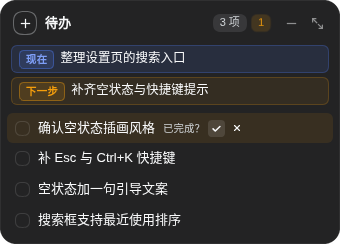
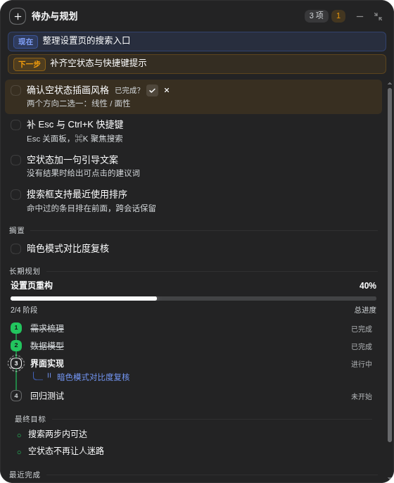

<div align="center">


<p><strong>给每个 DSH 会话一块可拖动的待办便签</strong><br>
短期待办、长期规划进度，以及自动注入给 agent 的记忆快照。</p>

<p>
  <a href="LICENSE"></a>
  
  
  
</p>

<p><strong>中文</strong> · <a href="README.en.md">English</a></p>

</div>

---

Todo Note 是一个 DeepSeek Harness（DSH）插件，在每个会话右上角放一块便签。它把三件事收进同一个视图：

- **你**不必翻聊天记录确认“现在做到哪、下一步是什么、哪些先搁置了”；
- **长期目标**有真实的阶段进度，而不是一句口号；
- **Agent** 每一轮拿到几行实时快照，不必为了回忆上下文而复读整段对话。

状态只写在本机，不联网、不上传。

<details>
<summary>目录</summary>

- [界面预览](#界面预览)
- [功能](#功能)
- [安装](#安装)
- [使用](#使用)
- [Agent 工具](#agent-工具)
- [配置](#配置)
- [数据与隐私](#数据与隐私)
- [跨平台](#跨平台)
- [实现](#实现)
- [排错](#排错)
- [开发](#开发)
- [许可](#许可)

</details>

## 界面预览

以下截图使用虚构的演示数据。

<table>
  <tr>
    <td align="center" width="42%">
      
      <br><sub><b>便签（默认）</b><br>现在 / 下一步、进行中任务，高度随内容自适应</sub>
    </td>
    <td align="center" width="58%">
      
      <br><sub><b>详情</b><br>任务与备注、搁置支线、阶段时间线、最终目标、最近完成</sub>
    </td>
  </tr>
</table>

<p align="center">
  
  <br><sub><b>悬浮球</b>：收起后只剩拖动把手，点击回到便签</sub>
</p>

## 功能

**短期待办**

- `现在` / `下一步` 两条焦点，分别用蓝色和琥珀色徽标标识，正文完整换行不截断。
- 进行中任务列表；列表顺序就是优先级，按住行上下拖动即可实时排序。
- 悬停行时浮出“搁置 / 删除”，常态不占标题宽度。

**长期规划**

- 阶段时间线：已完成阶段为绿色实心序号与绿色主线，进行中阶段为蓝字 + 旋转虚线圈。
- 按阶段权重计算的百分比；有阶段未完成时不会显示 100%。
- 挂起的任务可以作为蓝色折角支线挂在所属阶段下。

**完成前由你确认**

- Agent 调用 `todo_note_complete` 后，任务进入 `awaiting`，在标题下方单独一行、靠右出现 `已完成？ ✓ ✗`；确认按钮与鼠标悬停才出现的搁置/删除按钮分处两行，不会互相遮挡。
- 点 ✓ 才真正完成：划线 → 淡出 → 高度塌陷，只播放一次。
- 点 ✗ 则带着 `rejects` 计数退回进行中，agent 下次读到的快照里会出现“用户未通过”，据此先反思再改。

**记忆注入**

- 一条静态使用说明（prompt order 40）+ 每个会话一份实时快照（order 41，最多六行）。
- 你每改一次待办，下一轮 prompt 里的快照就会更新；插件在会话中途加载时会补挂到已在运行的 agent。

**交互**

- 三态：便签、悬浮球、详情；位置与形态记在浏览器 `localStorage`。
- 缩放时按卡片所在象限朝对应方向伸展（贴右则向右长、贴下则向下长），收起精确回到原位。
- 便签与详情都按内容定高：便签上限 420px，详情上限 `min(82vh, 720px)`；内容少时它们会缩到内容高度，不会停在空的大框上。
- 标题栏可拖动、双击复位；便签与详情靠近视口边缘时轻微吸附并滑入，留 16px 边距；**悬浮球拖到哪就停在哪，不吸附**。拖动过程 1:1 跟手（走合成层 `transform`，不重排文字），位移取整像素；拖动期间卡片内容退出命中测试，所以行悬停高亮、搁置/删除按钮不会在指针下闪动。松手最多一次 140ms 的减速，不回弹。

## 安装

要求 DSH 0.2.x（在 `0.2.1-rc.5` 上完成实测）。没有构建步骤，克隆下来即可安装。

### 方式一：插件管理界面（推荐）

1. 打开 DSH 左侧栏的「插件」页面。
2. 点右上角「添加插件」，在输入框里填入本仓库的 GitHub 地址，或本地克隆目录的绝对路径（含 `package.json` 的那一层）。
3. 点「安装」，完成后启用 `dsh-todo-note`。
4. 重启 DSH，然后刷新页面。

安装器会把目录以 `link:` 方式挂进 profile，并把 `dsh-todo-note` 登记到 profile 的 `dsh.profile.bundles`。

### 方式二：命令行

```bash
git clone <仓库地址> dsh-todo-note
cd dsh-todo-note
dsh plugin --profile web add "$(pwd)"
```

`dsh plugin` 只把参数转发给 profile 目录里的 pnpm，不会自动登记 bundle。因此还需要把包名加入 profile 的插件清单：打开 `$DSH_HOME/profiles/web/package.json`，在 `dsh.profile.bundles` 数组末尾追加 `"dsh-todo-note"`，然后重启 `dsh web`。

> `web` 是 Web 端与桌面端共用的 profile 名。不确定时先运行 `dsh plugin list` 查看。

### 方式三：手动注册（不推荐）

自行在 profile 的 `package.json` 依赖中加入 `"dsh-todo-note": "link:/绝对/路径"`，并同步 `dsh.profile.bundles`。手写容易与插件管理器冲突，优先使用前两种方式。

### 安装之后

- **重启 DSH 一次**再刷新页面。客户端插件的启动清单在进程启动时扫描，运行中重装或移动目录不会热更新。
- 面板应出现在会话右上角；若 Agent 已能调用 `todo_note_*` 工具而面板不出现，见[排错](#排错)。

### 卸载

```bash
dsh plugin --profile web remove dsh-todo-note
```

并在 profile 的 `dsh.profile.bundles` 中移除同名条目。卸载不会删除状态文件。

## 使用

| 操作 | 结果 |
| --- | --- |
| 点标题左侧 `⊕` | 展开输入框；`Enter` 提交，`Esc` 或 `✗` 关闭 |
| 输入框为空时点别处 | 自动收起；已有文字则保留，避免误删草稿 |
| 悬停任务行 | 右上角浮出“搁置 / 删除” |
| 按住任务行上下拖 | 实时排序：被拖的行跟手，其他行即时让位；落回原位不写盘 |
| 拖动标题栏或悬浮球 | 1:1 跟手移动；便签/详情离边缘 44px 内吸附并滑入，悬浮球不吸附 |
| 双击标题栏 | 复位到右上角 |
| `—` | 收成悬浮球 |
| `⤢` | 展开 / 收起详情 |

### 会话关联状态

便签按会话隔离，插件不会打扰一个还没在用它的会话。每个会话有一条隐藏的关联状态：

| 状态 | 面板 | agent 侧 |
| --- | --- | --- |
| 未关联 | 标题栏是一个低调的虚线「未关联」胶囊 | 下一轮 prompt 里多一行一次性提醒：用 `todo_note_read` 看一眼，再用 `todo_note_update` 写入现在 / 下一步和 1–3 条真实任务 |
| 已关联 | 恢复成「N 项」计数 | 只发快照，不再提醒 |

面板上的「未关联」胶囊本身是个按钮：点一下会直接向 agent 发一条「现在建立关联」的请求，关联成功后按钮自动消失。它是应急入口——正常情况下 agent 在下一轮就会收到提醒并自行关联。

关联一旦建立就不会回退（之后清空任务也不会重新提醒）。这也是「用户不特意提出，插件就不会主动关联」的实现方式：它只在第一次被使用时提醒一句，之后完全安静；用户明确要求时，agent 仍可随时读写任何会话的便签。

## Agent 工具

| 工具 | 作用 |
| --- | --- |
| `todo_note_read` | 读取当前会话的焦点、任务（含 id、状态、`rejects`）、阶段、目标与最近完成 |
| `todo_note_update` | 更新 `focus`、`add_tasks`、`update_tasks`、`remove_tasks`、`move_task`（排序 / 提优先级）、`set_plan`（整体替换阶段与目标） |
| `todo_note_complete` | 把任务置为 `awaiting`，等待用户在面板点 ✓ |

约定：

- 一个任务一件事，不要把多个子任务塞进一条标题。
- 阶段标题保持稳定，用户看到的是时间线。
- 被驳回的任务先反思再提交，不要重复同一做法。
- 开工先 `read`，每完成一步就 `update`。

## 配置

插件不注册 Schemastery 配置表单，以便在任意 DSH 0.2.x 版本上加载。要改默认值，在 profile 的 `cordis.patch.yml` 中给条目加 `config:`：

| 键 | 默认 | 含义 |
| --- | --- | --- |
| `injectPrompt` | `true` | 是否注入使用说明段 |
| `injectSnapshot` | `true` | 是否注入每会话实时快照 |
| `maxSessions` | `80` | 磁盘上保留的会话数量（LRU 截断） |
| `statePath` | `""` | 覆盖状态文件路径，空表示 `$DSH_HOME/todo-note/state.json` |

```yaml
- id: dsh-todo-note
  name: dsh-todo-note
  config:
    maxSessions: 30
```

## 数据与隐私

| 位置 | 内容 |
| --- | --- |
| `$DSH_HOME/todo-note/state.json` | 各会话的焦点、任务、计划、最近完成 |
| `localStorage` 的 `dsh-todo-note:prefs:v1` | 面板形态与坐标 |

- 只在本机读写，无外部请求、无遥测。
- 写入使用“临时文件 + rename”的原子替换，200ms 去抖，按会话分桶。
- 卸载不会删除数据；删除上述两项即可彻底清空。

## 跨平台

同一份代码在 Windows、macOS、Linux 上通用：

- 纯 JavaScript、纯 ESM，无原生依赖、无构建步骤、不调用 shell。
- 路径通过 `node:path` / `node:os` 构造；Windows 上状态文件位于 `%USERPROFILE%\.dsh\todo-note\state.json`。
- 原子写为“临时文件 + rename”，Windows 下 rename 失败会退避重试。
- 客户端只使用 `fetch`、`localStorage`、`document.baseURI`，没有平台相关 API。
- 插件声明 `platform: "web"`；桌面端加载同一套 GUI，因而同样显示。

> 说明：Windows 兼容性是按代码路径逐项核对（无 POSIX-only 调用、无硬编码路径、无 shell），**尚未在 Windows 真机跑过完整安装流程**。遇到问题请附 `dsh web` 日志提 issue。

## 实现

- **零构建**：`lib/host.js` 是普通 ESM 的 Cordis 插件；`lib/client.js` 是手写的 `window.__ModuleLoader__` 包，用 `React.createElement` 渲染，无 JSX、无打包器。
- **两半通信**：自建 HTTP 面 `/todo-note/api/get`（带 `since` 版本号，未变化时返回 `unchanged`）与 `/todo-note/api/act`；沿用官方插件的可信请求校验（校验 `Host`、拒绝 cross-site、同源或回环）。客户端使用相对路径，反向代理带前缀时也可用。
- **轮询**：可见 1.2s / 隐藏 4s / 失败退避 8s，不常驻 WebSocket。
- **样式**：只用 `--dsw-alias-*` 主题 token；动画只作用于 `transform`、`opacity`、`left`、`top`、`width`、`height`，并遵守 `prefers-reduced-motion`。
- **记忆**：`ctx.systemPrompt.section()` 注册静态说明（order 40）；在 `agent/created` 时给该 agent 注册读取实时状态的闭包段（order 41）。
- **测试**：`lib/model.js` 为纯函数，`node --test test/model.test.mjs` 共 18 个用例。

```
dsh-todo-note/
├── lib/
│   ├── host.js       # Cordis 插件：工具、HTTP 面、prompt 段、状态持久化
│   ├── client.js     # 面板：三态、拖动、实时排序、动画
│   └── model.js      # 纯数据模型：applyAction / progressOf / renderSnapshot
├── locale/           # 插件列表中的名称与描述
├── docs/
│   ├── logo.svg
│   └── screenshots/  # note.png / detail.png / ball.png
├── test/model.test.mjs
├── icon.svg
├── cordis.patch.yml
└── package.json
```

## 排错

**面板不出现，但 `todo_note_*` 工具可用**

客户端插件的启动清单在 DSH 进程启动时生成。运行中“卸载 → 换目录 → 重装”之后，宿主可能缓存旧的解析结果。重启 DSH 再刷新页面即可，数据不受影响。

**面板不出现，工具也不可用**

依次检查：

1. profile 的 `package.json` 中包含 `dsh-todo-note`，且 `dsh.profile.bundles` 已登记；
2. 插件管理页中该插件处于启用状态；
3. `$DSH_HOME/logs/` 下最新的 `web-*.log` 是否有 `failed to import` 或 `ERR_MODULE_NOT_FOUND`；
4. 若插件目录被移动过，重新执行一次安装，让 profile 指向新路径。

**修改后不生效**

客户端文件改动刷新页面即可；`lib/host.js` 的改动需要在插件管理页关闭再启用该插件，或重启 DSH。

## 开发

```bash
node --check lib/host.js
node --check lib/client.js
node --check lib/model.js
node --test test/model.test.mjs
```

修改后重载插件：插件管理页关闭再启用，或重启 DSH；浏览器端刷新页面。

## 许可

[MIT](LICENSE)
